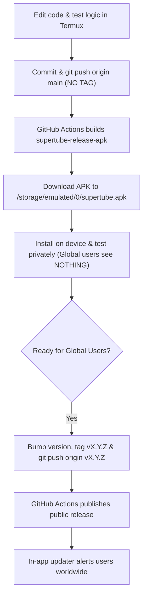

# SuperTube Project Knowledge Base & Architecture Reference

> [!IMPORTANT]
> **To any AI Assistant in a new conversation:**
> Read this document first. It preserves all critical architectural decisions, constraints, fixed regressions, signing secrets, and development workflows for **SuperTube** (`saimway/SuperTube`).

---

## 1. Project Overview & Environment Constraints

* **Project:** SuperTube (formerly Flow) — An Android video & music player with Netflix-style movies, YouTube client, local media, lyrics, sync, and recommendation engine.
* **Flavors:** `github` (in-app updater enabled) and `foss` (no updater).
* **Package Name / Application ID:** `io.github.aedev.flow` / `com.supertube`
* **Current Version:** `3.0.4` (`versionCode = 23`, `versionName = "3.0.4"`)
* **Repository:** `saimway/SuperTube` (`origin/main`)

### ⚠️ Critical Hardware Constraint: ZERO LOCAL GRADLE BUILDS
* The local environment is **Termux on an Android device**.
* **NEVER execute `./gradlew` commands locally** (`./gradlew assemble`, `test`, `build`, etc.). Doing so causes an immediate Out-Of-Memory (OOM) crash and freezes the device.
* **All builds, tests, and packaging MUST run remotely in GitHub Actions CI**.
* Termux is strictly used for code diagnosis, file edits, git operations (`git commit`, `git push`), and artifact downloading via `gh`.

---

## 2. Release Signing & Keystore Architecture (Fully Resolved)

* **Keystore Location:** `supertube.keystore` in repository root.
* **Credentials:**
  * Store Password: `supertube`
  * Key Alias: `supertube`
  * Key Password: `supertube`
  * Certificate Owner: `CN=SuperTube, OU=SuperTube, O=SuperTube, C=US`
  * SHA-256 Fingerprint: `B4:F6:B2:60:BE:AE:66:D8:41:C6:8B:B2:AB:3E:CB:30:66:6C:73:07:D3:A2:C0:82:F6:7E:5C:E1:7D:76:82:76`
* **Signing Scheme:** v1, v2, and v3 schemes are active in `app/build.gradle.kts`.
* **Base App Status:** SuperTube has been cleanly installed on the user's device with this keystore. All future builds sharing this key will update in-place with zero signature mismatches.

---

## 3. Play Protect & Updater Fixes Applied

1. **Eliminated High-Risk Permission:**
   * Removed `<uses-permission android:name="android.permission.UPDATE_PACKAGES_WITHOUT_USER_ACTION" />` from `app/src/github/AndroidManifest.xml`.
   * This was the primary heuristic trigger causing Google Play Protect to prompt "Scan required".
2. **Disabled Silent Auto-Updates:**
   * Removed `setRequireUserAction(USER_ACTION_NOT_REQUIRED)` from `AppUpdateInstaller.kt`.
   * Updates will always display the standard Android prompt (`[Cancel]` / `[Update]`) so the user is in full control.
3. **Preserved Storage Access:**
   * Retained `android.permission.MANAGE_EXTERNAL_STORAGE` in `app/src/main/AndroidManifest.xml` and original prompt logic in `DownloadLauncher.kt`.
4. **Purged External GitHub Links:**
   * Removed external repository URLs and "All releases on GitHub" buttons from UI views (`ChangelogSheet.kt`, `AboutScreen.kt`, `AboutIndex.kt`, `ReleaseNotes.kt`, `CrashSummary.kt`).

---

## 4. Movie Player Hardened Anti-Pop-Ad Engine

Located in `MoviePlayerScreen.kt`:
* **Strict Navigation Lockdown:** Confines WebViews to verified streaming provider domains; all external ad redirects are instantly dropped.
* **Defused Popup APIs:** Injected JavaScript neutralizing `window.open`, popunders, `alert`, `confirm`, `prompt`, and simulated clicks.
* **Click-Trap MutationObserver:** Continuously purges floating ad banners, transparent overlay traps (`z-index >= 1000`), and hijacked pointer events.
* **60+ Streaming Ad Network Blocklist:** Network interceptor drops connections to known tracking and ad servers.
* **Seek & Resume Memory:** Pure black canvas eliminates white screen flashes on seek, with automatic playback second persistence per title.

---

## 5. Future Development & Testing Workflow



### Commands Quick Reference:
* **Download Latest Test Build:**
  ```bash
  gh run download <RUN_ID> -n supertube-release-apk -D /data/data/com.termux/files/usr/tmp/new_build
  cp /data/data/com.termux/files/usr/tmp/new_build/supertube.apk /storage/emulated/0/supertube.apk
  termux-open /storage/emulated/0/supertube.apk
  ```
* **Publish Global Release:**
  ```bash
  git tag v3.0.5 && git push origin v3.0.5
  ```
